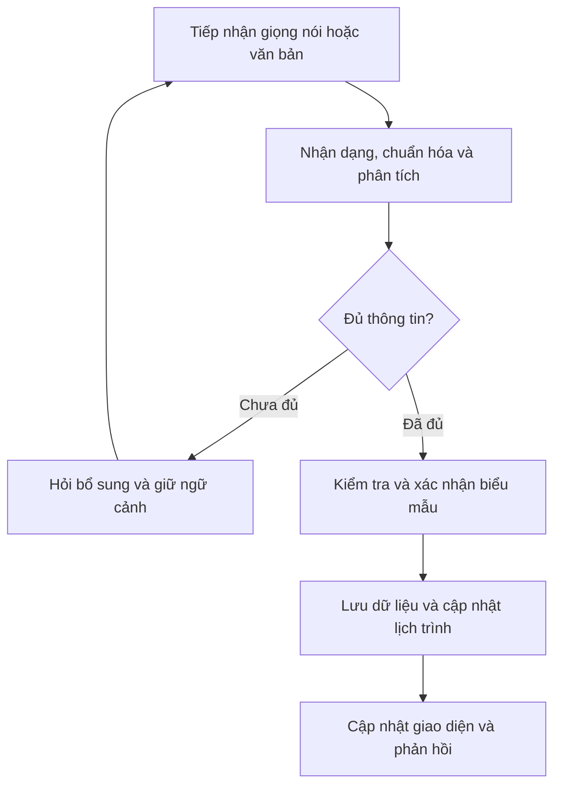

# Icare Assistant – Trợ lý y tế offline

**Dự án Android cá nhân hướng đến người cao tuổi, kết hợp quản lý lịch chăm sóc sức khỏe và tương tác bằng tiếng Việt.**

---

## 1. Tổng quan dự án

### 1.1. Giới thiệu

**Icare Assistant** là ứng dụng Android hỗ trợ quản lý các hoạt động chăm sóc sức khỏe hằng ngày. Người dùng có thể tạo lịch nhắc, theo dõi lịch khám, xem lịch sử thực hiện và tương tác với ứng dụng thông qua giọng nói hoặc giao diện.

Dự án ưu tiên xử lý trên thiết bị và lưu trữ cục bộ, nhằm giảm sự phụ thuộc vào kết nối Internet trong các thao tác thường ngày.

### 1.2. Vấn đề cần giải quyết

Người cao tuổi có thể gặp khó khăn khi ghi nhớ nhiều mốc thời gian, nhập thông tin trên màn hình nhỏ hoặc sử dụng giao diện có nhiều thao tác. Dự án tập trung vào ba nhu cầu:

- **Ghi nhớ lịch trình:** tập hợp lịch uống thuốc, sinh hoạt và lịch khám trong cùng một ứng dụng.
- **Giảm thao tác nhập liệu:** tiếp nhận yêu cầu bằng tiếng Việt và hỗ trợ điền thông tin vào biểu mẫu.
- **Theo dõi việc thực hiện:** lưu trạng thái và hiển thị lịch sử để người dùng tự kiểm tra.

### 1.3. Mục tiêu của dự án cá nhân

Dự án được phát triển để thực hành xây dựng một ứng dụng Android có đầy đủ luồng giao diện, xử lý nghiệp vụ và lưu trữ dữ liệu. Trọng tâm học tập gồm:

- Tổ chức mã nguồn theo trách nhiệm, giúp việc bảo trì và bổ sung tính năng thuận tiện hơn.
- Tích hợp nhận dạng giọng nói, xử lý ngôn ngữ và tổng hợp tiếng nói trên thiết bị.
- Quản lý trạng thái hội thoại, tác vụ bất đồng bộ và vòng đời thành phần Android.
- Kết nối các phần kỹ thuật thành một trải nghiệm sử dụng thống nhất.

## 2. Phạm vi và tính năng

### 2.1. Quản lý lịch nhắc uống thuốc và sinh hoạt

Người dùng có thể tạo, chỉnh sửa và xóa lịch nhắc; thiết lập nội dung, thời gian, chu kỳ lặp và khoảng nhắc trước. Với lịch uống thuốc, ứng dụng lưu thêm liều lượng và hướng dẫn do người dùng cung cấp.

Mỗi lịch nhắc được quản lý theo hai phần: thông tin chung của lịch và trạng thái của từng lần thực hiện. Cách tổ chức này hỗ trợ theo dõi các cữ riêng biệt trong một lịch lặp.

### 2.2. Phát lời nhắc và ghi nhận trạng thái

Ứng dụng kết hợp báo thức, thông báo và giọng đọc để nhắc người dùng. Các thao tác xác nhận hoàn thành, báo lại và hoàn tác được xử lý theo trạng thái của từng cữ nhắc.

Thông tin thực hiện được lưu để phục vụ việc xem lại lịch sử và tổng hợp mức độ hoàn thành.

### 2.3. Quản lý lịch khám

Ứng dụng hỗ trợ lưu và chỉnh sửa thông tin lịch khám, gồm mục đích, thời gian, địa điểm, bác sĩ và ghi chú. Các lịch này được hiển thị cùng lịch nhắc trong màn hình lịch trình.

Phần lập báo thức tự động cho lịch khám là hạng mục cần tiếp tục hoàn thiện.

### 2.4. Tương tác bằng tiếng Việt

Ứng dụng tiếp nhận giọng nói, chuyển thành văn bản và phân tích yêu cầu. Khi thông tin chưa đủ, hệ thống có thể hỏi bổ sung trước khi mở biểu mẫu để người dùng kiểm tra và lưu.

Chế độ nhập văn bản hỗ trợ sử dụng và kiểm tra luồng xử lý khi chưa có điều kiện nhận dạng giọng nói.

### 2.5. Hồ sơ, lịch sử và cài đặt

- Quản lý thông tin cá nhân và thông tin sức khỏe do người dùng nhập.
- Xem lịch sử lịch nhắc, lịch khám và thống kê mức độ hoàn thành.
- Điều chỉnh tốc độ giọng đọc và thời gian lưu lịch sử.

### 2.6. Hỗ trợ liên hệ khẩn cấp

Ứng dụng có luồng nhận diện yêu cầu khẩn cấp, hỏi xác nhận và chuyển sang thao tác gọi điện. Cách thực hiện cuộc gọi phụ thuộc quyền được cấp và khả năng của thiết bị.

Số liên hệ hiện được cấu hình cố định trong mã nguồn; việc cho phép người dùng thiết lập số liên hệ thuộc định hướng mở rộng.

## 3. Nguyên lý hoạt động

Luồng xử lý tổng quát khi người dùng tạo lịch:



### 3.1. Tiếp nhận yêu cầu

Người dùng bắt đầu tương tác qua micro hoặc nhập văn bản. Với giọng nói, bộ nhận dạng chuyển dữ liệu âm thanh thành văn bản và cập nhật kết quả nhận dạng lên giao diện.

Văn bản sau đó được chuẩn hóa để giảm khác biệt về cách viết và cách biểu đạt trước khi phân tích.

### 3.2. Phân tích ý định và thông tin

Bộ xử lý ngôn ngữ xác định hành động người dùng muốn thực hiện và trích xuất các thông tin liên quan. Model TensorFlow Lite được kết hợp với quy tắc từ khóa và quy tắc trích xuất để xử lý các nhóm yêu cầu được hỗ trợ.

Kết quả phân tích gồm văn bản, ý định, các thông tin đã nhận diện và độ tin cậy của model.

### 3.3. Điều phối hội thoại

Ngữ cảnh hội thoại lưu lại luồng đang thực hiện và thông tin đã thu thập. Hệ thống kiểm tra dữ liệu còn thiếu để quyết định hỏi tiếp, chuyển sang biểu mẫu, kết thúc hoặc hủy luồng.

Việc giữ ngữ cảnh giúp xử lý các câu trả lời tiếp nối trong cùng một yêu cầu.

### 3.4. Kiểm tra và lưu dữ liệu

Thông tin thu thập được chuyển đến biểu mẫu tương ứng. Người dùng kiểm tra, bổ sung hoặc điều chỉnh dữ liệu trước khi xác nhận lưu.

Các UseCase điều phối việc tạo, cập nhật và truy xuất dữ liệu thông qua repository. Dữ liệu được lưu trên thiết bị bằng Room.

### 3.5. Lập lịch và phản hồi

Với lịch nhắc đã được hỗ trợ, bộ lập lịch đăng ký thời điểm kích hoạt với hệ thống Android. Khi đến thời điểm xử lý, receiver kiểm tra trạng thái hiện tại trước khi phát thông báo và giọng đọc.

Sau mỗi thao tác, ứng dụng cập nhật trạng thái giao diện, dữ liệu liên quan và phản hồi cho người dùng.

## 4. Kiến trúc và nguyên tắc thiết kế

### 4.1. Cách tổ chức tổng thể

Dự án tổ chức theo hướng **Clean Architecture**, kết hợp **MVVM** ở phần giao diện. Mã nguồn được chia thành các nhóm trách nhiệm:

| Thành phần | Trách nhiệm chính |
| --- | --- |
| Presentation | Hiển thị, tiếp nhận tương tác và quản lý trạng thái màn hình |
| Domain | Biểu diễn nghiệp vụ, điều phối UseCase và định nghĩa các hợp đồng |
| Data | Triển khai lưu trữ, xử lý giọng nói và truy cập dịch vụ Android |
| DI | Khởi tạo và kết nối các dependency |
| Core | Chứa các thành phần dùng chung |

Mục tiêu của cách chia này là hạn chế việc một thay đổi về giao diện, lưu trữ hoặc engine xử lý ảnh hưởng đến toàn bộ ứng dụng.

### 4.2. Presentation Layer

Presentation chứa Activity, Fragment, ViewModel, adapter và các trạng thái giao diện.

- **Activity, Fragment:** hiển thị nội dung, nhận thao tác và xử lý điều hướng.
- **ViewModel:** tiếp nhận yêu cầu từ giao diện, phối hợp với UseCase và cung cấp trạng thái.
- **UiState, sự kiện giao diện:** biểu diễn quá trình chờ, lắng nghe, xử lý, phản hồi hoặc lỗi.
- **Adapter, biểu mẫu:** trình bày danh sách và thu thập dữ liệu có cấu trúc.

LiveData hỗ trợ cập nhật giao diện theo trạng thái. ViewBinding cung cấp liên kết giữa mã Java và các thành phần XML.

### 4.3. Domain Layer

Domain tập hợp các thành phần biểu diễn và điều phối nghiệp vụ:

| Nhóm | Vai trò |
| --- | --- |
| `ai` | Khai báo các hợp đồng dịch vụ nhận dạng, phân tích và tổng hợp giọng nói |
| `model` | Biểu diễn lịch nhắc, lịch sử, lịch khám, hồ sơ và kết quả xử lý |
| `dialog` | Quản lý ngữ cảnh, trạng thái và hành động hội thoại |
| `repository` | Định nghĩa cách truy cập dữ liệu và các khả năng xử lý |
| `usecase` | Điều phối từng thao tác nghiệp vụ của ứng dụng |

Việc sử dụng hợp đồng repository giúp phần điều phối có thể làm việc với các cách triển khai khác nhau. Tính độc lập của Domain là định hướng thiết kế tiếp tục được hoàn thiện; hiện một số model vẫn sử dụng annotation của Room.

### 4.4. Data Layer

Data chứa phần triển khai cụ thể cho các hợp đồng và các kết nối với nền tảng:

- **ASR – nhận dạng giọng nói:** chuyển âm thanh thành văn bản bằng Vosk.
- **NLU – hiểu ngôn ngữ:** chuẩn hóa văn bản, phân loại ý định và trích xuất thông tin.
- **TTS – tổng hợp tiếng nói:** cấu hình giọng đọc, phát phản hồi và quản lý callback.
- **Local:** khai báo cơ sở dữ liệu Room và các DAO.
- **Repository:** phối hợp giữa nghiệp vụ với nguồn dữ liệu hoặc engine.
- **Receiver, Utils:** xử lý báo thức, thông báo và các tiện ích hỗ trợ.

Data sử dụng Android SDK và các thư viện bên ngoài để thực hiện những tác vụ phụ thuộc thiết bị.

### 4.5. Dependency Injection

Dự án sử dụng **DI thủ công** thông qua `AppContainer`. Thành phần này khởi tạo cơ sở dữ liệu, engine, repository, UseCase và cung cấp chúng cho các ViewModel thông qua factory.

Cách làm này giúp theo dõi rõ thứ tự khởi tạo và quan hệ phụ thuộc khi quy mô dự án còn nhỏ.

### 4.6. Nguyên tắc khi phát triển thêm

- Đặt xử lý nghiệp vụ vào thành phần phù hợp với trách nhiệm của nó.
- Ưu tiên giao tiếp qua hợp đồng để thuận tiện thay thế cách triển khai.
- Xử lý các tác vụ nặng ngoài luồng giao diện và quản lý tài nguyên theo vòng đời.
- Giữ dữ liệu và trạng thái nhất quán khi cập nhật hoặc hủy một thao tác.
- Từng bước giảm truy cập trực tiếp từ giao diện đến chi tiết lưu trữ.

## 5. Cấu trúc mã nguồn

Package chính: `com.example.trolyyte`.

```text
app/src/main/
├── java/com/example/trolyyte/
│   ├── core/                 Thành phần dùng chung
│   ├── data/
│   │   ├── asr/              Nhận dạng giọng nói
│   │   ├── nlu/              Phân tích ngôn ngữ
│   │   ├── tts/              Tổng hợp tiếng nói
│   │   ├── local/            Database và DAO
│   │   ├── repository/       Triển khai repository
│   │   ├── receiver/         Xử lý sự kiện báo thức
│   │   └── utils/            Chuẩn hóa dữ liệu và lập lịch
│   ├── domain/
│   │   ├── ai/               Hợp đồng dịch vụ giọng nói và ngôn ngữ
│   │   ├── dialog/           Điều phối hội thoại
│   │   ├── model/            Mô hình dữ liệu và trạng thái
│   │   ├── repository/       Hợp đồng repository
│   │   └── usecase/          Xử lý nghiệp vụ
│   ├── presentation/         Màn hình, ViewModel và thành phần giao diện
│   └── di/                   AppContainer và kết nối dependency
├── assets/                   Model và dữ liệu ngôn ngữ
├── res/                      Layout, hình ảnh, chuỗi và giao diện
└── AndroidManifest.xml       Khai báo thành phần và quyền ứng dụng
```

## 6. Công nghệ sử dụng

| Công nghệ | Mục đích sử dụng |
| --- | --- |
| Java, Android SDK | Phát triển logic ứng dụng và tích hợp nền tảng |
| XML, Material Components, ConstraintLayout | Xây dựng và bố trí giao diện |
| ViewModel, LiveData, ViewBinding | Quản lý trạng thái và cập nhật màn hình |
| Vosk | Chuyển giọng nói thành văn bản trên thiết bị |
| TensorFlow Lite | Chạy model phân loại ý định cục bộ |
| Quy tắc từ khóa, biểu thức chính quy | Bổ trợ phân loại và trích xuất thông tin |
| Android Text-to-Speech | Đọc phản hồi và lời nhắc tiếng Việt |
| Room / SQLite | Lưu trữ dữ liệu có cấu trúc trên thiết bị |
| SharedPreferences | Lưu các tùy chọn của ứng dụng |
| AlarmManager, Notifications | Đặt thời điểm và hiển thị lời nhắc |
| Gradle, Android Gradle Plugin | Quản lý dependency và quy trình build |

## 7. Cài đặt và chạy dự án

### 7.1. Yêu cầu môi trường

| Thành phần | Yêu cầu |
| --- | --- |
| Android Studio | Hỗ trợ Android Gradle Plugin 8.5 |
| JDK chạy Gradle | JDK 17 |
| Mức tương thích mã Java | Java 11 theo cấu hình ứng dụng |
| Android SDK | API 34 |
| Gradle | Sử dụng Wrapper 8.13 đi kèm project |
| Thiết bị chạy | Thiết bị thật hoặc máy ảo Android 8.0 trở lên |

Cần kết nối Internet trong quá trình chuẩn bị để tải dependency, model và dữ liệu giọng đọc.

### 7.2. Chuẩn bị tài nguyên giọng nói

| Tài nguyên | Vị trí | Cách chuẩn bị |
| --- | --- | --- |
| Model NLU, tokenizer và nhãn | `app/src/main/assets/models/` | Đã có trong project |
| Model Vosk tiếng Việt | `app/src/main/assets/model-vn/` | Bổ sung model và giữ nguyên cấu trúc tài nguyên |
| Engine TTS và giọng đọc tiếng Việt | Trên thiết bị Android | Cài đặt và kiểm tra khả năng phát tiếng Việt |

Model Vosk cần có file `uuid` để quản lý phiên bản khi giải nén. Tham khảo [danh sách model Vosk](https://alphacephei.com/vosk/models) và [cách đóng gói trên Android](https://github.com/alphacep/vosk-android-demo/blob/master/models/build.gradle).

Có thể kiểm tra luồng tương tác bằng chế độ nhập văn bản khi chưa chuẩn bị model nhận dạng. Để phát giọng đọc offline, thiết bị cần có dữ liệu giọng tiếng Việt hỗ trợ chế độ này.

### 7.3. Mở và chạy trong Android Studio

1. Mở thư mục gốc của project.
2. Kiểm tra đường dẫn Android SDK và đặt Gradle JDK về JDK 17.
3. Đồng bộ Gradle để tải dependency và nhận diện module ứng dụng.
4. Chuẩn bị thiết bị thật hoặc khởi động máy ảo tương thích.
5. Chọn cấu hình **app**, chọn thiết bị và nhấn **Run** trên thanh công cụ.

### 7.4. Quyền và thiết lập trên thiết bị

Micro phục vụ nhận dạng giọng nói; thông báo và báo thức phục vụ các lịch nhắc. Luồng gọi điện sử dụng quyền tương ứng hoặc chuyển đến giao diện quay số.

Người dùng cần kiểm tra các quyền và thiết lập liên quan đến chức năng muốn sử dụng. Khả năng hiển thị thông báo và hoạt động nền còn phụ thuộc phiên bản Android cùng cài đặt của thiết bị.

## 8. Hướng dẫn sử dụng

### 8.1. Tương tác với trợ lý

1. Tại **Trang chủ**, nhấn micro để thu âm hoặc nhấn giữ để nhập văn bản.
2. Cung cấp thông tin bổ sung khi ứng dụng hỏi lại.
3. Kiểm tra và điều chỉnh dữ liệu trong biểu mẫu được mở.
4. Xác nhận lưu để tạo lịch.

### 8.2. Quản lý lịch trình

- Mở **Đặt lịch** để xem và quản lý lịch nhắc, lịch khám.
- Chọn tạo mới hoặc chỉnh sửa thông tin của lịch hiện có.
- Khi nhận lời nhắc, xác nhận hoàn thành hoặc chọn báo lại.
- Các thao tác khả dụng phụ thuộc trạng thái của từng lịch; kết quả được cập nhật vào lịch sử.

### 8.3. Theo dõi hồ sơ và lịch sử

Trong **Hồ sơ**, người dùng có thể truy cập:

| Khu vực | Thao tác |
| --- | --- |
| Thông tin cá nhân | Xem và cập nhật hồ sơ |
| Lịch sử | Xem các lịch đã ghi nhận và mức độ hoàn thành |
| Cài đặt | Điều chỉnh tốc độ đọc và thời gian lưu lịch sử |

Các chỉ số tổng hợp được tính từ trạng thái dữ liệu đã ghi nhận, phục vụ việc tự theo dõi trong ứng dụng.

## 9. Định hướng mở rộng

- **Chức năng:** cấu hình liên hệ khẩn cấp và các thao tác qua hội thoại.
- **Ngôn ngữ:** cải thiện nhận dạng tiếng Việt, trích xuất thông tin và duy trì ngữ cảnh.
- **Trải nghiệm:** đơn giản hóa giao diện, nâng cao khả năng tiếp cận và hỗ trợ nhiều kích thước màn hình.
- **Kỹ thuật:** ưu hiệu năng, độ ổn định.

